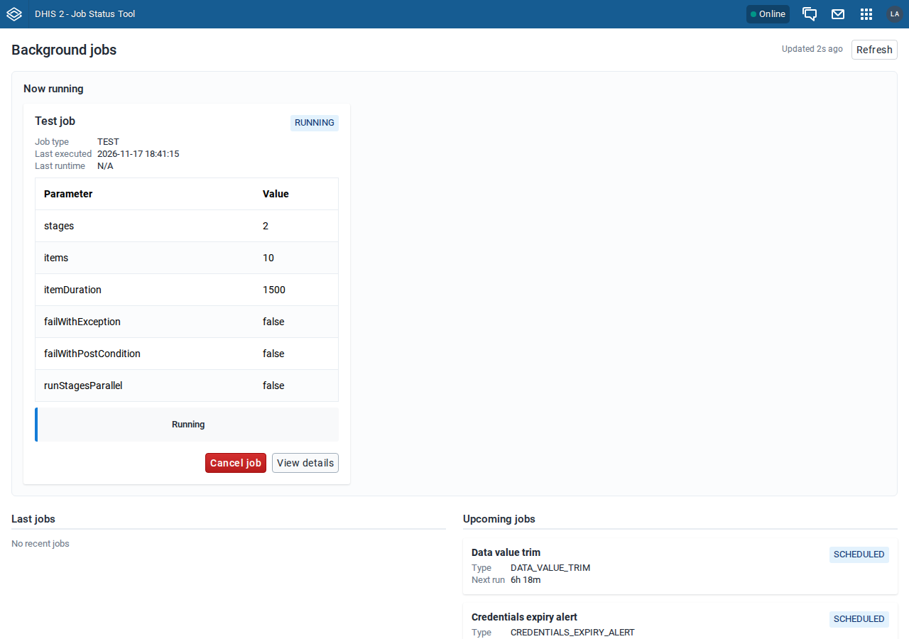
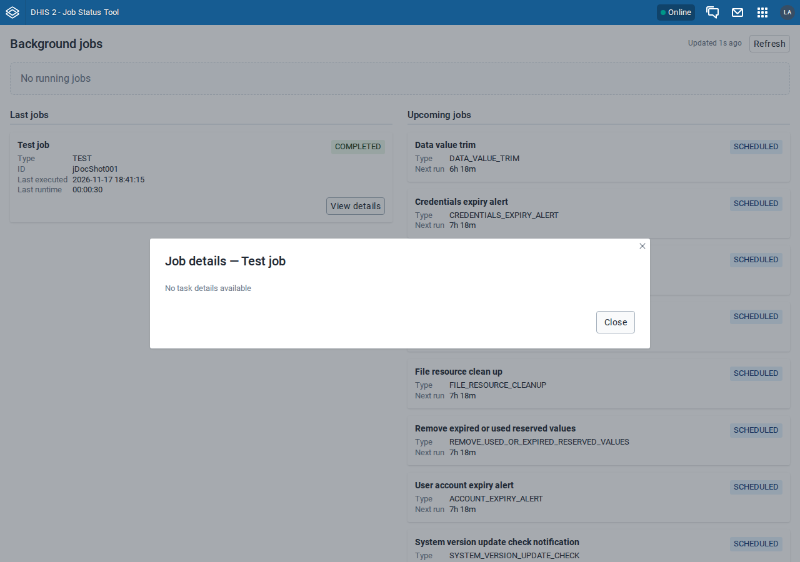
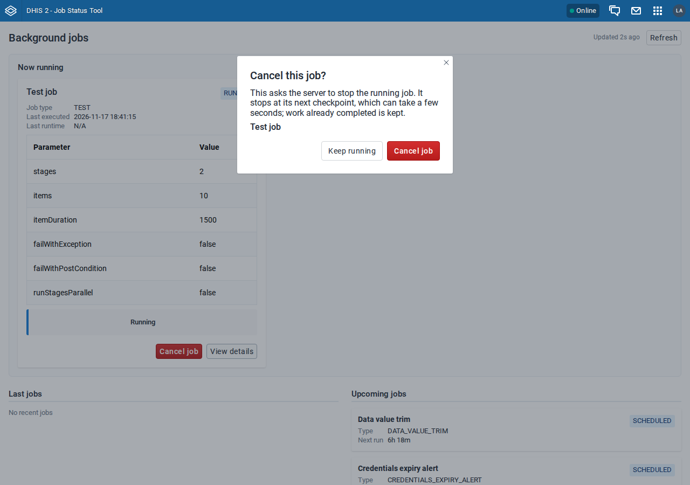

# Job Status Tool { #tool-job-status }

## What the tool is for { #tool-job-status-about }

The Job Status Tool shows the background jobs of a DHIS2 instance on one page: the jobs that run now, the jobs that finished last, and the jobs that run next. A system administrator can also cancel a running job.

## Before you start { #tool-job-status-before-you-start }

- The tool works with DHIS2 2.40 to 2.43. To cancel a job, you need DHIS2 2.41 or later.
- To open the tool, your user role must give access to the Job Status Tool app. In the Users app, this is the authority "tooljobstatus app" (`M_tooljobstatus`). No other authority is needed to see the jobs.
- The **Cancel job** button is shown to superusers, to users with the `F_PERFORM_MAINTENANCE` authority, and to the user who started the job. The server applies the same rule.

> **Warning**
>
> Cancelling a job stops work that the job has not done yet. For example, a cancelled analytics job leaves the analytics tables of the years that it did not reach unchanged. Try the tool on a copy of the database before you use it on a production server.

## Install the tool { #tool-job-status-install }

You can install the tool in two ways:

- Download `tool-job-status-<version>.zip` from the [releases page](https://github.com/dhis2-utils/tool-job-status/releases) of the tool. Then open the **App Management** app and upload the zip file.
- Install it from the DHIS2 Admin Toolbox app.

The tool is not published on the App Hub.

If you used a 0.x version of the tool, uninstall the old "Job Status Tool" app after you install 1.0.0 or later. The new version has a different app key, so DHIS2 installs it as a separate app. Add the new app to the user roles that gave access to the old one.

## See the background jobs { #tool-job-status-overview }

Open the Job Status Tool. The page **Background jobs** has three parts:

- **Now running** shows each job that runs now, with a progress line. A job in a job queue is shown with the other jobs in its queue, with its position, for example "Job 2 of 3". When nothing runs, the page shows "No running jobs".
- **Last jobs** shows the six jobs that finished most recently, with their status, the time they started and how long they ran.
- **Upcoming jobs** shows the next ten scheduled jobs and the time until each one runs.

All times are in the time zone of the DHIS2 server, which can be different from your own.

The page updates every three seconds. The text next to **Refresh** shows when the data was last updated. To update the page now, click **Refresh**.

The tool does not show the housekeeping job, which runs every minute.

## See the details of a job { #tool-job-status-details }

1. Find the job under **Now running** or **Last jobs**.
2. Click **View details**.

   The **Job details** window shows the last five messages of the job. For a predictor job, it also shows the prediction summary: how many values were inserted, updated, deleted and unchanged.

3. Click **Close**.

## Cancel a running job { #tool-job-status-cancel }

> **Warning**
>
> The job stops before it has done all its work. Work that it already did is kept.

1. Find the job under **Now running**.
2. Click **Cancel job**.
3. In the window **Cancel this job?**, click **Cancel job** to confirm. To leave the job running, click **Keep running**.

   The button changes to **Cancelling…**. The job stops at its next checkpoint, which can take a few seconds. When it has stopped, it moves to **Last jobs** with the status STOPPED.

If the job still runs 30 seconds after you cancelled it, the button **Cancel job** comes back, so that you can try again.

## Known limitations { #tool-job-status-limitations }

- The tool shows what the DHIS2 API reports about jobs. It cannot always show the correct state. For example, if the server restarts while a job runs, DHIS2 can report the job as running after it has stopped.
- Many job types do not report progress. For these jobs the progress line shows "Running" until the job ends.
- On DHIS2 2.40, you cannot cancel jobs, because 2.40 has no cancel function in its API.
- The tool shows the job type and parameter names as DHIS2 reports them, in English. Status names such as RUNNING and STOPPED are not translated.
- The tool polls the server every three seconds while it is open. Close it when you do not need it, to save server load.
